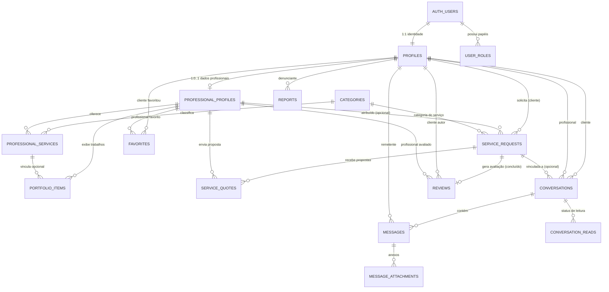

# 📘 Arquitetura e Modelagem do Banco de Dados — GO Parauapebas

Marketplace de Profissionais Autônomos desenvolvido sobre **PostgreSQL** e **Supabase**, preparado para integração com aplicativo **Flutter** e painel web/administrativo.

---

## 1. Diagrama de Relacionamentos (ERD)



---

## 2. Dicionário de Dados e Tabelas

### 2.1 Usuários e Perfis
* **`profiles`**: Dados cadastrais unificados com `auth.users` (nome, telefone/WhatsApp, foto, cidade `Parauapebas`, bairro).
* **`user_roles`**: Papéis de acesso (`client`, `professional`, `moderator`, `admin`). O RLS impede que qualquer usuário insira ou altere o próprio papel.
* **`professional_profiles`**: Especialidades do autônomo, biografia, bairros atendidos em Parauapebas, anos de experiência, situação (`active`, `pending_approval`, `suspended`), contagem de serviços concluídos, chave PIX e notas médias calculadas por triggers.
* **`categories`**: Categorias de serviços com slug, ícone (compatível com Material Icons do Flutter) e ordem de exibição.
* **`professional_services`**: Tabela associativa com preços base, unidades de cobrança (`por_hora`, `por_servico`, `diaria`, `a_combinar`) e descrição do serviço.
* **`portfolio_items`**: Fotos dos trabalhos realizados armazenadas no Supabase Storage (`portfolios`) com ordenação.

### 2.2 Solicitações e Orçamentos Multi-Profissional
* **`service_requests`**: Pedido de serviço criado pelo cliente. Pode ser direcionado a um profissional específico ou aberto para a categoria no bairro especificado.
  * Estados: `pending`, `accepted`, `in_progress`, `completed`, `cancelled`.
  * Timestamps automáticos para início, conclusão e cancelamento com motivo.
* **`service_quotes`**: Permite que múltiplos profissionais enviem propostas independentes para uma mesma solicitação de serviço, negociando preço, prazo e condições.

### 2.3 Chat Interno em Tempo Real
* **`conversations`**: Conversa privada entre cliente e profissional, opcionalmente associada a uma solicitação de serviço. Mantém cache da última mensagem para carregamento ultra rápido na lista de chats do Flutter.
* **`messages`**: Histórico imutável de mensagens de texto com remetente autenticado.
* **`message_attachments`**: Registro de fotos/áudios/arquivos vinculados a uma mensagem, apontando para o bucket privado `chat_attachments`.
* **`conversation_reads`**: Registro de última mensagem lida por cada participante, permitindo exibir contador de "mensagens não lidas" e confirmação de leitura no Flutter.

### 2.4 Confiança, Segurança e Moderação
* **`reviews`**: Avaliação de 1 a 5 estrelas e comentário. **Regra de integridade:** permitida somente para serviços com status `completed`, impedindo avaliações falsas ou duplicadas.
* **`favorites`**: Lista de profissionais salvos pelo cliente para contratações recorrentes.
* **`reports`**: Canal de denúncia para perfis suspeitos, mensagens ofensivas ou desacordos comerciais. Somente moderadores e administradores têm acesso ao tratamento.

---

## 3. Segurança e Políticas RLS (Row Level Security)

1. **Proteção Total por Padrão**: Todas as tabelas têm `ROW LEVEL SECURITY` ativado.
2. **Isolamento de Chat**: Apenas os participantes de uma conversa têm permissão SQL para ler ou enviar mensagens na respectiva conversa.
3. **Imutabilidade de Remetente**: O `sender_id` é validado obrigatoriamente como `auth.uid()`, impedindo que um usuário se passe por outro.
4. **Proteção Administrativa**: Funções `SECURITY DEFINER` (`is_admin()`, `is_moderator_or_admin()`) garantem que apenas administradores autenticados possam alterar privilégios.
5. **Storage Control**:
   - `avatars`: público para leitura, gravação restrita ao diretório do usuário autenticado (`auth.uid()/*`).
   - `portfolios`: público para leitura, gravação restrita ao profissional.
   - `chat_attachments`: **100% privado**, acessível apenas pelos usuários autenticados participantes da conversa.

---

## 4. Guia de Integração com o Flutter

### Passo 1: Adicionar Dependências no `pubspec.yaml`
```yaml
dependencies:
  flutter:
    sdk: flutter
  supabase_flutter: ^2.8.0
```

### Passo 2: Inicializar no `main.dart`
```dart
import 'package:flutter/material.dart';
import 'package:supabase_flutter/supabase_flutter.dart';

Future<void> main() async {
  WidgetsFlutterBinding.ensureInitialized();

  await Supabase.initialize(
    url: const String.fromEnvironment('SUPABASE_URL'),
    anonKey: const String.fromEnvironment('SUPABASE_ANON_KEY'),
  );

  runApp(const GoParauapebasApp());
}

final supabase = Supabase.instance.client;
```

> **Atenção:** NUNCA utilize a chave `service_role` dentro do aplicativo Flutter. Utilize estritamente a chave pública `anon`.

### Passo 3: Consultas de Exemplo no Flutter

#### Buscar Categorias Ativas:
```dart
final response = await supabase
    .from('categories')
    .select()
    .eq('active', true)
    .order('display_order', ascending: true);
```

#### Listar Profissionais por Bairro de Parauapebas:
```dart
final professionals = await supabase
    .from('professional_profiles')
    .select('''
      id,
      bio,
      rating_average,
      rating_count,
      profiles!inner (
        full_name,
        avatar_url,
        phone_whatsapp,
        neighborhood
      ),
      professional_services (
        title,
        base_price,
        category:categories (name)
      )
    ''')
    .eq('status', 'active')
    .contains('served_neighborhoods', ['Cidade Nova']);
```

#### Escutar Mensagens em Tempo Real (Supabase Realtime Stream):
```dart
final messagesStream = supabase
    .from('messages')
    .stream(primaryKey: ['id'])
    .eq('conversation_id', currentConversationId)
    .order('created_at', ascending: true);
```
